<h1 align="center">3D of Things</h1>

<p align="center"><b>How things work, taken apart.</b><br>A free, browser-based library of real machines you can turn over, look inside and pull to pieces,<br>built object by object with <code>/3d-of-things</code>, a Claude Code skill that makes each one the same careful way.</p>

<p align="center">
  <a href=".claude/skills/3d-of-things/SKILL.md"></a>
  <a href="https://threejs.org"></a>
  <a href="LICENSE"></a>
  <a href="#models"></a>
  <a href="#requirements"></a>
  <a href="#checks"></a>
</p>

<p align="center">
  <a href="#quick-start">Quick start</a> ·
  <a href="#the-objects">The objects</a> ·
  <a href="#whats-on-a-page">What's on a page</a> ·
  <a href="#the-skill">The skill</a> ·
  <a href="#how-it-works">How it works</a> ·
  <a href="#checks">Checks</a> ·
  <a href="#limits">Limits</a>
</p>

<p align="center">
  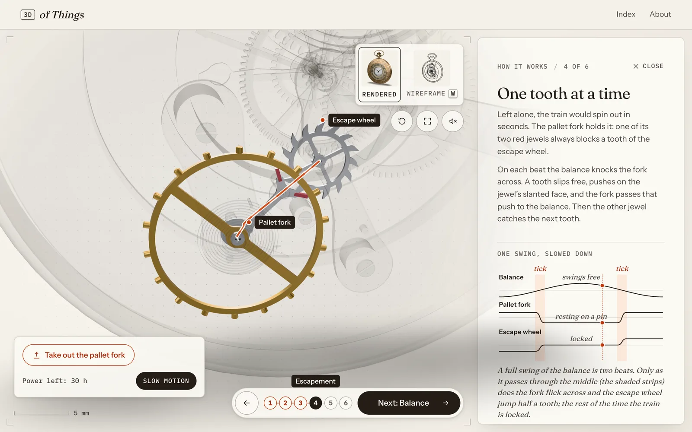
</p>

<p align="center"><sub>The pocket watch's escapement in <b>How it works</b>. The case turns to glass, the parts the step is about stay solid and run, and the chart beside them is drawn from the same beat count that turns the wheels.</sub></p>

---

Every object on the site is a real machine with real insides: a watch movement with true tooth counts and a Swiss lever escapement, a Leica's cloth shutter and rangefinder, a Hasselblad's mirror, flaps and leaf shutter in the order of its service manual's timing chart, a car's four strokes. Where a free model is only a shell, the insides are generated in code from the real numbers. Nothing is guessed by an AI segmenter.

Each object has its 3D model to turn and take apart, numbered callouts, scale drawings, and a step-by-step tour that follows the energy through the mechanism, with live charts and experiments to try. Every number on screen comes from the same maths that moves the parts.

## Quick start

See the site:

```sh
npm install
npm run dev        # http://localhost:5173
```

Add an object. Install the skill once:

```sh
npx skills add bro-xuan/3d-of-things
```

Then, in Claude Code, in any folder:

```text
/3d-of-things add a mechanical metronome
```

Claude sizes it, writes a truth sheet of real numbers and sources, scaffolds the object (its page works within minutes), builds the model and its insides, writes the tour, and checks every callout, step and experiment in a headless browser before it's done. Outside this repository it first sets up a workspace, a clone of it, because the repository is the skill's kit; inside it, the skill is already there (`.claude/skills/3d-of-things`). `npm run export` then puts the machines on your own site ([Deploying](#deploying)).

## The objects

<table>
  <tr>
    <td width="50%">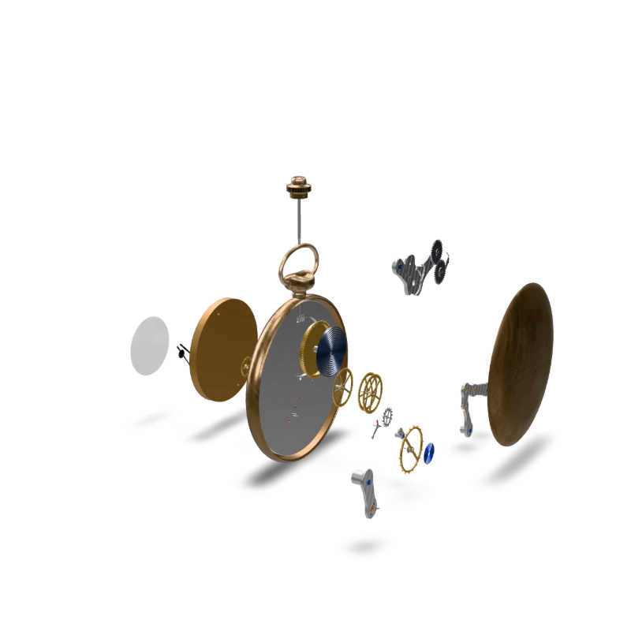</td>
    <td width="50%">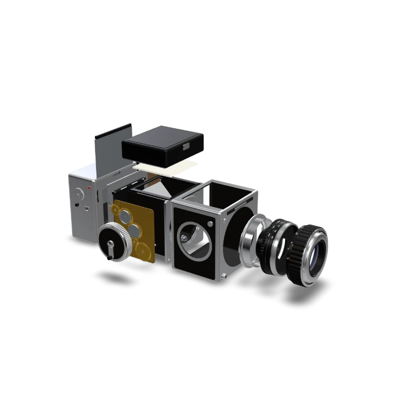</td>
  </tr>
  <tr>
    <td><sub><b>Pocket watch</b>: a 26-part movement generated inside a Poly Haven case, running in step with your clock, with slow motion for the escapement.</sub></td>
    <td><sub><b>Medium-format SLR</b>: built entirely in code after the Hasselblad 500C/M, from its service manual's dimensions and release sequence.</sub></td>
  </tr>
  <tr>
    <td>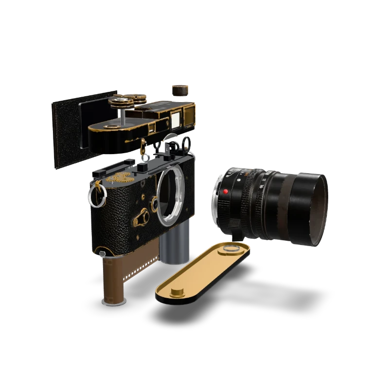</td>
    <td>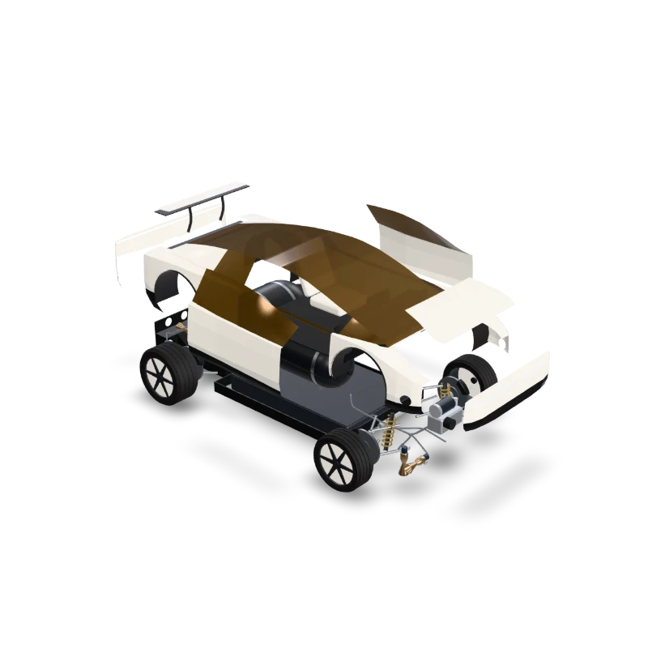</td>
  </tr>
  <tr>
    <td><sub><b>Rangefinder camera</b>: a Leica M3 shell opened along its seams, with cloth curtains, film transport, rangefinder optics and a nine-blade iris inside.</sub></td>
    <td><sub><b>Tesla Roadster (2026)</b>: the suction fans that hold it to the road and the cold-gas thrusters that make it fly, from Tesla's October 2026 launch.</sub></td>
  </tr>
  <tr>
    <td>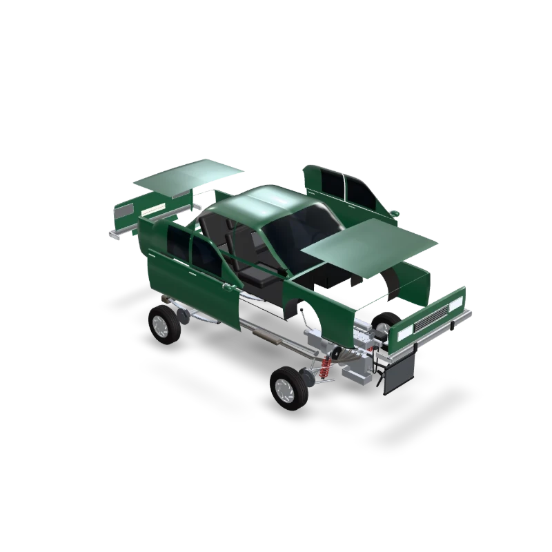</td>
    <td>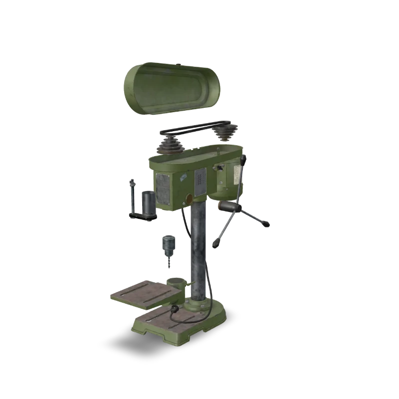</td>
  </tr>
  <tr>
    <td><sub><b>Family car</b>: a two-litre four with its pistons, valves and firing order, a four-speed gearbox and a differential you can take round a bend.</sub></td>
    <td><sub><b>Drill press</b>: move the belt between the stepped pulleys and watch the spindle speed change.</sub></td>
  </tr>
  <tr>
    <td>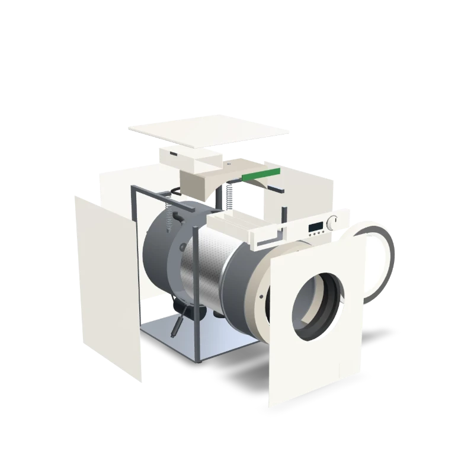</td>
    <td>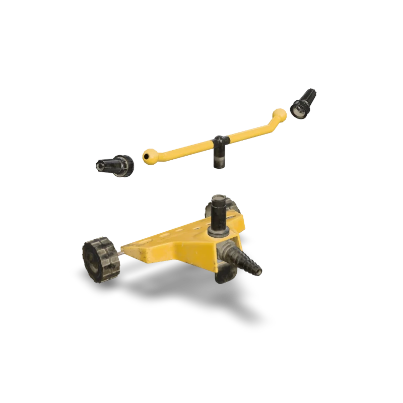</td>
  </tr>
  <tr>
    <td><sub><b>Washing machine</b>: built in code: a drum driven by a belt from a small fast motor, a tub hung on springs with 25 kg of concrete, and the water's way in, round and out.</sub></td>
    <td><sub><b>Garden sprinkler</b>: no motor: two jets push the arm round as a rocket's exhaust pushes the rocket. Pick a pressure and watch the speed and the throw change.</sub></td>
  </tr>
</table>

Also on the site: a **hand drill** (an 80-tooth wheel turning a 24-tooth pinion), **binoculars** (the prisms that fold the light and turn the picture upright), a **microscope**, an **8 mm film projector** (the claw and the two-bladed shutter, in step) and a **bicycle pump** (a cup seal that folds one way and a ball valve that keeps the tyre's air in).

## What's on a page

<table>
  <tr>
    <td width="33%">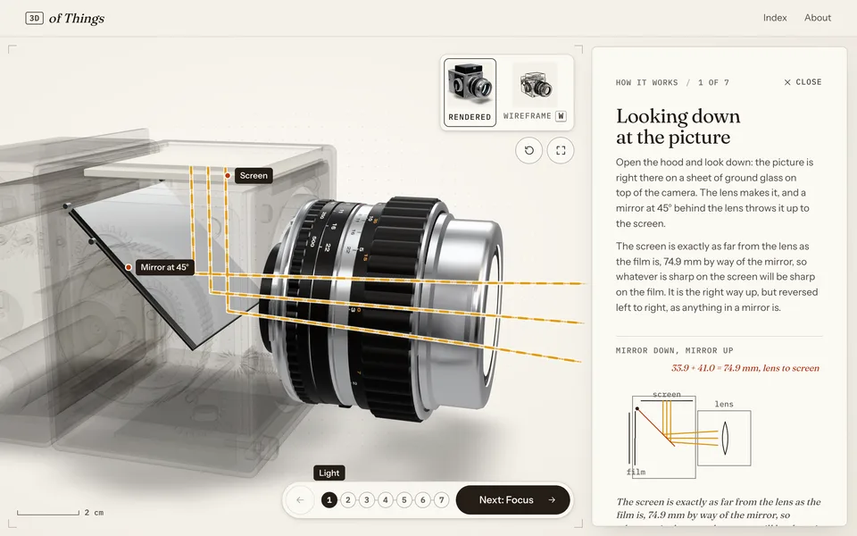</td>
    <td width="33%">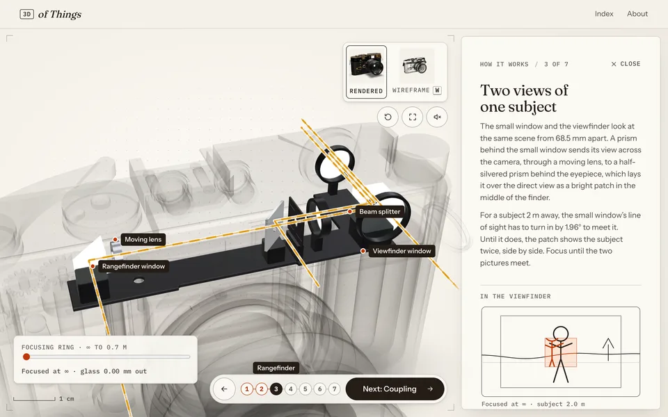</td>
    <td width="33%">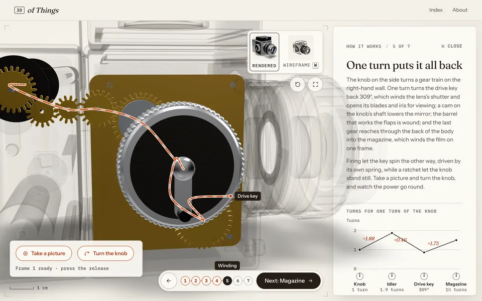</td>
  </tr>
  <tr>
    <td>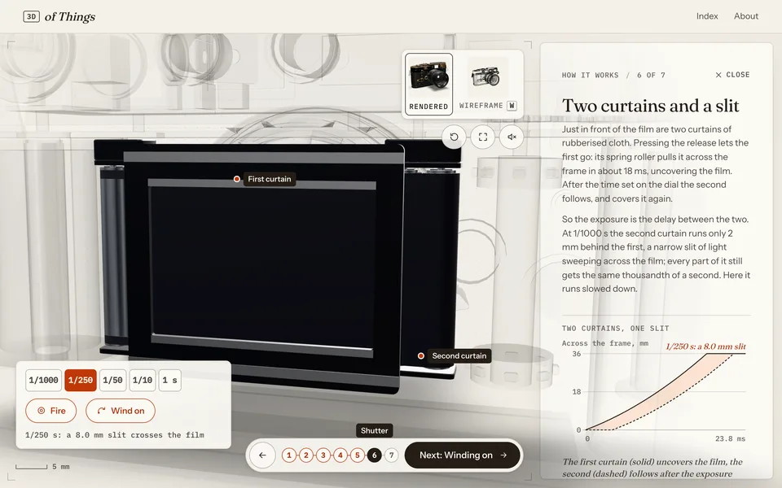</td>
    <td>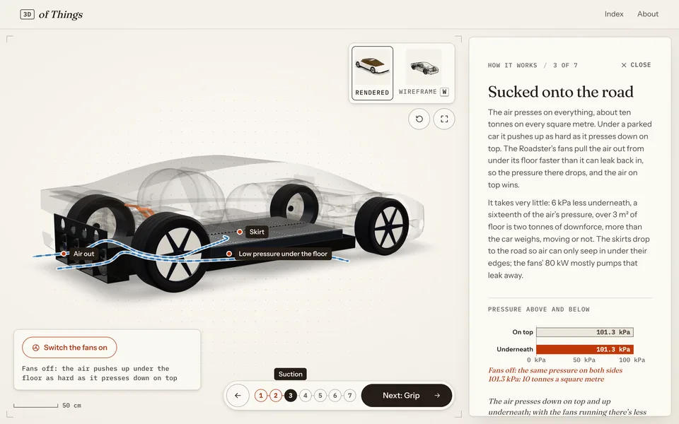</td>
    <td>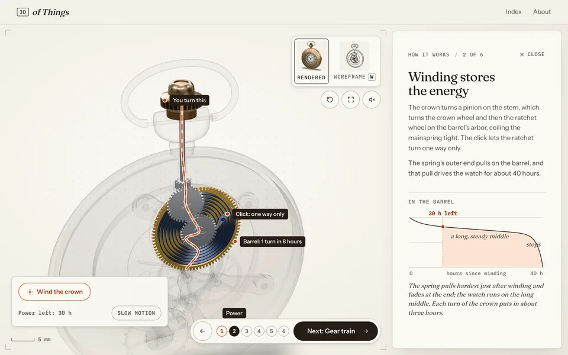</td>
  </tr>
</table>

- **A 3D viewer**: drag, zoom, pan, arrow keys. On wide screens the model stands on a layer above the page, solid and whole, and moving to another object hands one model over to the next.
- **Take it apart**: a slider and a button. Parts come off in stages, outer parts first, along paths the build has checked clear.
- **Callouts**: numbered markers on the model; picking one flies the camera to it and opens the model if what it shows is inside. Click any part for a card beside it.
- **How it works**: a tour of the mechanism, one stage of the energy chain per step. The parts a step is about stay solid and the rest turn to glass; a line draws the path the power, light or air takes; labels pin live numbers to the parts; a chart runs in step with the model; and there's something to try: wind the watch, hold its balance, take out its pallet fork and watch the train run away, focus the Leica until the rangefinder's images meet, fire the SLR in slow motion, switch on the Roadster's fans and fly it.
- **Rendered and wireframe**: two cards switch the look with a scan line that redraws the model in ink, hidden edges faint (key W).
- **Drawings**: top, front and side views drawn from the model at one scale, dimensioned at its real size. Pick one and the model turns to match.
- **A scale bar** at the model's real size, and the model's credit and licence.

## The skill

[`/3d-of-things`](.claude/skills/3d-of-things/SKILL.md) is the standard procedure for one object, written as a Claude Code skill so every object is made the same way and nothing is relearned. It lives in this repository because the repository is its kit: the viewer, the model pipeline, the generator kit and the checks.

**The one idea: real insides, really moving.** A shell with labels is a catalogue. The object explains itself when its insides are true and they work.

The skill has a page of its own, [`skill.html`](skill.html): run `npm run dev` and open `/skill.html`. Baked into afrodance.fun, it's the page at `/3d-of-everything`, with the objects at `/3d-of-everything/objects` (see [Deploying](#deploying)).

It sizes each object first:

| Tier | What | Examples | Budget |
|---|---|---|---|
| **A · Sourced** | A CC0 model with its parts as separate nodes | garden sprinkler, hand drill | 15–30 min |
| **B · Opened** | A CC0 shell, cut open in code, the insides generated | bicycle pump, pocket watch | 15–60 min |
| **C · Built** | No usable model: the whole object generated in code | washing machine, the SLR | 25–60 min |
| **D · Machine** | Several systems with their own physics | the 2026 Roadster | 2 h+, proposed as a C first |

Then it works through eight stages, each with an exit check:

1. **Brief**: exactly which object, whether it's new to the site, the energy chain in a line.
2. **Truth sheet**: sources, real numbers, the energy chain, one misconception to correct, the parts in groups, the tour. A research subagent does the digging.
3. **Scaffold**: `npm run new -- <slug> --tier …` writes the object's folder from templates, builds a first model and page, and checks it, in seconds.
4. **Model**: the shell cut open, or the whole object generated, with the kit. The build fails if any two parts collide, or if taking it apart would pass one part through another.
5. **Content**: the words and the tour, placed by named anchors from the build, never by pasted coordinates.
6. **Mechanism**: only for a kind the site doesn't have; everything that exists is reused first.
7. **Check**: `npm run check` and `npm run qa` until both pass and the contact sheets have been read.
8. **Ship**: posters, this README, the production build.

The skill's [references](.claude/skills/3d-of-things/references) hold the depth: [the procedure](.claude/skills/3d-of-things/references/procedure.md), [explaining a machine](.claude/skills/3d-of-things/references/explaining.md), [the content file](.claude/skills/3d-of-things/references/content.md), [the model and the kit](.claude/skills/3d-of-things/references/model.md), [mechanisms](.claude/skills/3d-of-things/references/mechanisms.md), [checks](.claude/skills/3d-of-things/references/qa.md) and [lessons](.claude/skills/3d-of-things/references/lessons.md).

### How long it takes

Detail costs time, so here are the real numbers: Claude's active time per object, measured from the session logs with `npm run timing`.

| Object | Tier | Before the skill | Of that, hand-made browser checks |
|---|---|---|---|
| Pocket watch movement | B | 1 h 47 | 27% |
| Leica M3 | B | 2 h 07 | 37% |
| Hasselblad-type SLR | C | 1 h 59 | 33% |

The biggest cost wasn't the modelling: it was checking. Every object got its own Playwright scripts, launched with software WebGL at about 460 ms a frame, with fixed sleeps of 2.5–4.5 s per view. The skill replaces them with one runner driven by the content file, on the GPU (18–23 ms a frame), which checks a whole object in about a minute and all thirteen in under two. With the scaffold, the generator kit and named anchors, the target was about an hour for a tier B or C object, with more checks than before.

The first three objects made with the skill, on 18 October 2026, came in well under it. All three were built in one session: 70 minutes from the request to the last poster, with each object's research running in a subagent alongside.

| Object | Tier | With the skill, to its posters | Of that, checks |
|---|---|---|---|
| Washing machine (30 parts, built in code) | C | 24 min | 38% |
| Bicycle pump (a shell opened, its insides generated) | B | 15 min | 38% |
| Garden sprinkler | A | 15 min | 46% |

Measured with `npm run timing -- --item <slug>`, which counts the calls that touch the object. The research subagents, the truth sheets' write-up and fixes to shared tools (a viewer bug, three kit helpers) come on top.

## How it works

```text
3d-of-things/
├── content/<slug>.json         one file per object: text, parts, callouts, motions, tour, credit
├── public/models/<slug>.glb    compressed models (meshopt geometry, WebP textures)
├── public/posters/             gallery posters and tray thumbnails, rendered from the models
├── objects/<slug>/             made with the skill: truth sheet, content builder, generator
├── scripts/
│   ├── build-models.mjs        generate or augment, check, compress, write hints
│   ├── check-content.mjs       npm run check: content against model, no browser
│   ├── qa/                     npm run qa: browser checks, GPU launch, contact sheets
│   ├── kit/                    the generator kit: building blocks, assembly, checks
│   ├── new-object.mjs          npm run new: scaffold an object from the skill's templates
│   ├── timing.mjs              npm run timing: where a build's time went
│   ├── truth-tables.mjs        npm run truth: the truth sheet's parts and tour tables, from what was built
│   ├── export-site.mjs         npm run export: the site built to live inside another one (afrodance.fun)
│   └── watch/ camera/ hasselblad/ cars/   the generators of the objects built before the skill
├── src/
│   ├── pages/                  gallery, object page, about, the 3D layer, How it works
│   ├── viewer/                 the three.js viewer and the mechanisms (clockwork, cameras, aerocar)
│   └── charts/                 the tour's charts, drawn from the numbers the model runs on
└── .claude/skills/3d-of-things/    the skill: SKILL.md, references/, templates/, evals/
```

The site is static (Vite, TypeScript and three.js, no framework, no backend). Routing is hash-based and asset URLs are relative, so `dist/` works from any host or sub-path. The gallery is plain DOM; three.js is only fetched when an object page opens, after its poster is on screen.

<details>
<summary><b>The pocket watch's movement</b></summary>

<br>

The Poly Haven watch is a closed case with three hands, so the movement inside is generated: `scripts/watch/` runs as a build step (`build.augment` in `content/pocket-watch.json`). It cuts the case into the pieces that come apart (crystal, dial, case back, crown) along the mesh's own edge loops, adds the inside surfaces a closed shell never had, and builds about 20 parts from real tooth counts: barrel and mainspring, a centre-seconds train (80/10, 75/10, 84/7), a Swiss lever escapement at 21,600 beats an hour, balance and hairspring, motion works and keyless winding. The build fails if any two parts overlap, if anything pokes through the domed case back, if the explode in the content file would pass one part through another, or if the model's bounds move (which would shift every position in the content file).

In the viewer, every wheel, the pallet fork, the balance and the hairspring are driven from one beat count taken from the visitor's clock, so the train stays in mesh at any time of day and in slow motion. The keyless works turn too: winding the crown in "How it works" turns the stem's winding pinion, the crown wheel and the ratchet wheel (each its own node), rocks the click over the ratchet's teeth and coils the mainspring tighter, and the balance swings wider or narrower with what's left in the spring (but at the same rate). The timing lives in `src/viewer/clockwork.ts`, which the charts read too. The design lives in `scripts/watch/movement.mjs` (`layout` for positions, the `H` table for heights); after changing it, `npm run models:build -- pocket-watch` prints the moving parts' axes in model space, for the content file's `motion` pivots.

</details>

<details>
<summary><b>The rangefinder camera's insides</b></summary>

<br>

The Poly Haven camera is a Leica M3 as a closed shell: body, top cover and base in one mesh, a lens, and a strap lying in front of it. `scripts/camera/` runs as its build step (`build.augment` in `content/rangefinder-camera.json`). It cuts the shell along planes at the cover's and the base plate's seams (splitting the triangles that cross, so the texture carries on across the cut) into the top cover, the body, the base plate and the back door, and gives each its inside: the shell thickened inward with a rim along every cut edge (`surgery.mjs`). The windows' fake dark boxes become openings, the lens comes apart into the parts that turn and slide when it focuses, and the strap goes (its rings stay on the lugs).

`mechanism.mjs` then builds what's inside, laid out like an M3 (the film 27.8 mm behind the bayonet's face, the rangefinder's windows 68.5 mm apart): the shutter's two cloth curtains on their rollers in front of a 24 × 36 mm gate, the film from its cassette over an eight-tooth sprocket to the take-up spool, the advance gears, the rangefinder (window prism, the moving lens on the roller arm that rides the lens's cam, the frame-line mirror and mask, the beam splitter and finder lenses), and the lens's nine-blade iris. The build fails if any generated part crosses another piece at rest, or if the explode in the content file would pass one piece through another (both checked on the meshes themselves, in 3D).

In the viewer, the camera's parts don't move with time but with its controls: `src/viewer/filmcamera.ts` turns focusing, the aperture ring, the release and the lever's two strokes into values (lens extension, stop, how far each curtain has run, frames wound on), and `src/viewer/linkage.ts` turns those into the content file's motions: turns and slides, a curtain winding off one roller onto the other (`cloth.ts`, which runs the same sums as the build), and the film's perforations moving along it.

</details>

<details>
<summary><b>The medium-format SLR, built in code</b></summary>

<br>

There is no free model of a Hasselblad to start from, so the whole camera is generated: `scripts/hasselblad/` runs as its build step (`build.generate` in `content/reflex-camera.json`) and returns a glTF document instead of editing a downloaded one. `layout.mjs` holds the dimensions that matter: the lens's flange 74.9 mm from the film, a 56 mm square picture, a screen as far from the lens (by way of the mirror) as the film is. `body.mjs` builds the cast shell (a box rounded on every edge, its openings cut with the rangefinder's surgery tools and thickened inward), leatherette, the chassis (bayonet plate, mirror box, rear plate), the mirror hinged at its top back edge, the two rear flaps, the winding gears on the right-hand wall (sized so one turn of the knob turns the drive key back 30/35 of a turn, the 309° a release spins it) and the knob. `lens.mjs` builds an 80 mm f/2.8 of the Planar type with a five-blade leaf shutter and a five-blade iris, with engraved scales drawn as SVG; `back.mjs` the film magazine (insert, rollers, 120 spools, the film's path as tangents between them, gears from the body, frame counter, dark slide); `finder.mjs` the folded hood. The same clash and explode-path checks as the rangefinder's run on it.

In the viewer, `src/viewer/reflexcamera.ts` runs the release in the order of the factory service manual's timing chart: the lens's shutter shuts and the drive key turns to 117°, the iris stops down, the mirror swings up, the flaps open, the key reaches 268° and the shutter fires; letting go closes the flaps and the key ends at 309°. One turn of the knob lowers the mirror, turns the key back (cocking and opening the lens) and winds on a frame; the dark slide locks the release. The charts in `src/charts/reflex.ts` draw from the same functions.

</details>

<details>
<summary><b>The cars, built in code</b></summary>

<br>

Both cars are generated by `scripts/cars/` (`build.generate` in the content file, with `build.car` naming a spec in `scripts/cars/specs/`). A spec is a car's dimensions (length, wheelbase, track, wheels and tyres) and its shape, drawn as a few (z, value) curves: for the lower body the sill, the widest point, the beltline's crease, the wings' crowns and the bonnet and deck down the middle; for the canopy its foot, the glass line and the roof. `body.mjs` lofts both through those curves, and `generate.mjs` cuts out the panels that come off (doors, bonnet, boot, bumpers) along the loft's own rows and stations, so every seam is a clean line; cuts the wheel arches and any openings the spec lists; and picks out the lights, trim and glass. `fittings.mjs` adds what an older car has bolted on, and `interior.mjs` builds the seats, dashboard, screen and steering wheel. The same clash and explode-path checks as the cameras' run on both.

Under the Roadster's body `platform.mjs` builds an electric car's skateboard: a thick pack of 4680 cells in the floor, a drive unit for each rear wheel, half shafts, double wishbones and coil-overs, the steering rack and the orange high-voltage cables. `aero.mjs` builds what makes the 2026 car different, laid out from Tesla's descriptions and its "Electric Fan Car" patent: four ducted fans in the tail fed by a duct from an inlet in the floor, skirts round the sealed floor, two carbon-wound air tanks (about 600 litres), the compressor, the valve block and the lines, and ten de Laval nozzles. Under the family car's, `engine.mjs` builds a two-litre four (a crankshaft with its counterweights, pistons on their rods, an overhead camshaft whose lobes are set round it in the firing order 1-3-4-2), the clutch, a four-speed gearbox with real tooth counts, the propshaft, and a live rear axle with its differential (a 10-tooth pinion and a 39-tooth crown wheel).

The content files are written by `node scripts/cars/content.mjs <car>` (always name the car). In the viewer, the family car's pistons and rods follow the crank and its valves the camshaft (`src/viewer/rig.ts`); the Roadster's fans, skirts and wing move by controls that `src/viewer/aerocar.ts` sets as it runs the suction, the tanks emptying, a standing start on the rear thrusters, and two flights flown by the car's computer; `src/viewer/jets.ts` draws each nozzle's jet.

</details>

## Checks

Two checkers, both driven by the content file, so a new object is checked with no new code.

```sh
npm run check                 # every object against its model, no browser: under a second
npm run qa -- reflex-camera   # callouts, tour steps, experiments, phone: about a minute
npm run qa -- --all --quick   # every object, three at a time, and the skill's page: under two minutes
npm run qa -- --skill         # the skill's page: its live watch winds, slows and comes apart
npm run qa -- --all --deployed --url https://afrodance.fun/3d-of-everything/objects   # a built or live copy
```

`check` finds names the model doesn't have, meshes in no part, positions off the model, charts and experiments that don't exist, and unfinished text. `qa` drives the real page in headless Chromium on the GPU: it holds every hold button, moves every slider, fires every shutter, fails if a readout never changes, and tiles what it saw into a few labelled contact sheets:

<p align="center">
  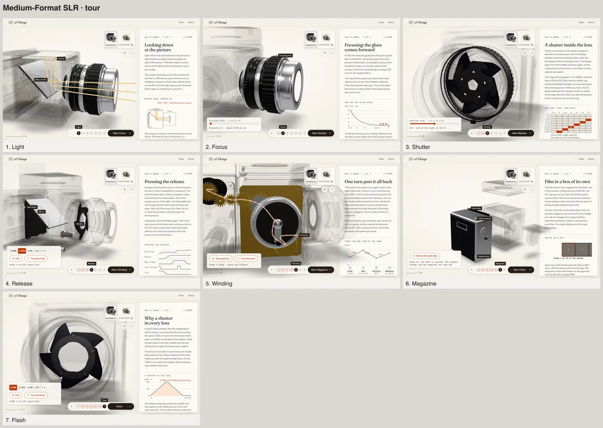
</p>

The model build has its own checks: it fails if any generated part crosses another at rest, or if the content file's explode would pass one part through another.

## Requirements

| | Needed for | Notes |
|---|---|---|
| **Node.js 22+** | everything | Built and tested on Node 25. |
| **Playwright's Chromium** | `qa`, `posters` | `npx playwright install chromium` if it's missing. On a Mac it draws with the GPU through Metal; elsewhere it falls back to SwiftShader (slower). |
| **[Claude Code](https://code.claude.com/docs/en/overview)** | the skill | `npx skills add bro-xuan/3d-of-things`, or open it in this repository; then type `/3d-of-things`. |

```sh
npm run build      # type-check, then build to dist/
npm run preview    # serve dist/
```

## Limits

- **Free models only.** CC0 or CC BY, checkable at the source. Most free models are shells, so most objects need their insides generated, which is the slow part.
- **Generated insides are simplified**, and each page says what was left out. They follow real dimensions and real timing, not every screw.
- **It's careful, not instant.** A simple machine takes 15 to 25 minutes of Claude's time. One as dense as the watch took nearly two hours before the procedure existed, and a vehicle with its own physics takes longer.
- **3D needs WebGL.** Without it, each page shows its poster.

## Models

| Object | Model | Made by | License |
| --- | --- | --- | --- |
| Hand Drill | [Vintage Hand Drill](https://polyhaven.com/a/vintage_hand_drill) | Yann Kervran & Benjamin McDonnell | CC0 1.0 |
| Pocket Watch | [Vintage Pocket Watch](https://polyhaven.com/a/vintage_pocket_watch) (case, dial, hands); movement built for this site | Tal Swicegood | CC0 1.0 |
| Binoculars | [Vintage Binoculars](https://polyhaven.com/a/vintage_binocular) | Luke | CC0 1.0 |
| Microscope | [Vintage Microscope](https://polyhaven.com/a/vintage_microscope) | Luis José Fernández Rodríguez | CC0 1.0 |
| Film Projector | [Filmstrip Projector 8mm](https://polyhaven.com/a/filmstrip_projector_8mm) | PeterM | CC0 1.0 |
| Drill Press | [Drill Press 01](https://polyhaven.com/a/drill_press_01) | Viktor | CC0 1.0 |
| Rangefinder Camera | [Camera 01](https://polyhaven.com/a/Camera_01) (body, lens and dials); shutter, film transport, rangefinder optics and iris built for this site | Rajil Jose Macatangay | CC0 1.0 |
| Medium-Format SLR | built in code for this site (`scripts/hasselblad/`), after the Hasselblad 500C/M | 3D of Things | CC0 1.0 |
| Tesla Roadster | built in code for this site (`scripts/cars/`) from Tesla's October 2026 launch photographs and figures | 3D of Things | CC0 1.0 |
| Family Car | built in code for this site (`scripts/cars/`), a typical rear-wheel-drive saloon of the 1970s and 80s; no particular make | 3D of Things | CC0 1.0 |
| Washing Machine | built in code for this site (`objects/washing-machine/`), a typical European front-loader; no particular make | 3D of Things | CC0 1.0 |
| Bicycle Pump | [Tire Pump](https://polyhaven.com/a/tire_pump); piston, cup seal, air passage and ball valve built for this site | Garrison Gager | CC0 1.0 |
| Garden Sprinkler | [Garden Sprinkler 01](https://polyhaven.com/a/garden_sprinkler_01) | Amal Kumar | CC0 1.0 |

All but the SLR, the washing machine and the two cars from [Poly Haven](https://polyhaven.com). Tesla and the Roadster's name are trademarks of Tesla, Inc.; the Roadster here is an illustration made for this site, which has nothing to do with Tesla, and its insides are simplified (Tesla hasn't shown the layout of its tanks, lines and nozzles). The film projector's loose power cord is hidden in the viewer, and the camera's strap is left off. The explanations were written for this site.

## Deploying

The site is baked into the personal site, [afrodance.fun](https://afrodance.fun) (a Next.js app), at `/3d-of-everything`:

```sh
npm run export -- --out ../afrodance.fun/public/3d-of-everything
```

The export builds the site with every URL under `/3d-of-everything/` and copies it into that `public/` folder, replacing an earlier export but never anything else. Two rewrites in afrodance.fun's `next.config.ts`, which the export prints, serve `skill.html` at `/3d-of-everything` and the gallery at `/3d-of-everything/objects`. Served, the baked copy is checked with `npm run qa -- --all --deployed --url <address>/3d-of-everything/objects`, and it goes live when that repository's `main` deploys on Vercel. The models and posters are committed, because the build only copies them.

Any other static host works too: `npm run build` writes `dist/` with relative URLs, so it can be served from any path.

## Contributing

Read [CONTRIBUTING.md](CONTRIBUTING.md): how to add or change an object, the checks a change has to pass, and the house rules.

## Licence

The code and the skill are [MIT](LICENSE). The models carry their own licences, all CC0, listed in [Models](#models); the ones built in code are MIT with the rest.
